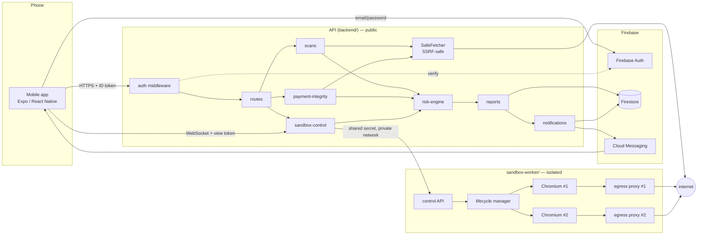
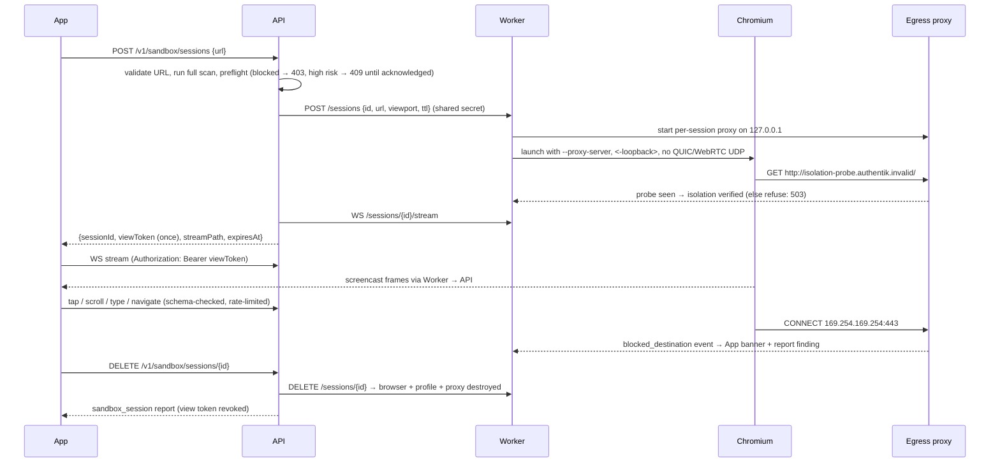

# Architecture

> **Scope changed on 2026-10-24** to Android automatic fraud detection. The target architecture
> (native Kotlin notification listener and VPN, domain engine, threat-list updates) is in
> [scope.md](scope.md#architecture). This document describes the code as it is built today,
> and all of it carries over.

Authentik has three security capabilities — **website scanning**, **isolated Sandbox
browsing** and **payment-flow integrity checks** — that stay separate but feed one
**risk engine**. Each produces *findings* plus a record of which *checks* ran; the risk engine
turns those into a verdict with an explanation. Everything else (reports, alerts, settings,
account) is built around those assessments.



## Components

| Component | Path | Responsibility |
|---|---|---|
| Shared contracts | `packages/shared` | Types for findings, assessments, API DTOs and Sandbox messages; URL normalisation and redaction; the destination policy (`policy.ts`) and DNS checks (`net.ts`, Node-only) used by both the API and the worker. |
| API | `backend/` | Express 5 + TypeScript. Verifies Firebase ID tokens, runs scans and payment checks, owns the risk engine, stores reports/alerts in Firestore, and is the Sandbox control plane. |
| Sandbox worker | `sandbox-worker/` | One disposable Chromium per session behind a per-session filtering egress proxy. Streams a screencast, applies viewer input, reports security events. No database or Firebase credentials. |
| Mobile app | `mobile/` | Expo Router app. Feature folders mirror the backend modules. Imports **types only** from `@authentik/shared`. |

### Backend modules

```
backend/src/
├── modules/
│   ├── auth/                  token verification, account lifecycle (profile, revoke, delete)
│   ├── scans/                 orchestration + lookalike, domain signals, RDAP, page evidence
│   ├── reputation/            Google Safe Browsing, local blocklist
│   ├── merchant-verification/ registry of merchants, payment providers and banks
│   ├── payment-integrity/     expected-vs-observed comparison, demo checkout scenarios
│   ├── risk-engine/           deterministic verdict rules + explanation text
│   ├── reports/               create/list/get/delete with retention
│   ├── notifications/         alert policy, dedupe, FCM push
│   └── settings/              preferences and the privacy statement
├── sandbox-control/
│   ├── sessions/              lifecycle manager, viewer relay, reaper
│   ├── workers/               HTTP/WebSocket client for the worker
│   └── policies/              preflight, message schemas, event → finding mapping
├── security/
│   ├── url-validation/        input → normalised URL + static policy
│   ├── ssrf-protection/       SafeFetcher (validated DNS, manual redirects, caps)
│   ├── rate-limiting/         per-IP and per-user limits
│   └── audit/                 pseudonymous security audit log
├── integrations/              extension point for retailer / payment-provider / bank partners
└── storage/                   Collection interface: Firestore and in-memory implementations
```

The API stays a single modular service. The worker is the one separate execution boundary,
because it runs hostile code.

## The risk model

```ts
Finding    { code, source, kind, severity, quality, title, reason, observedAt, hardBlock?, data? }
CheckRun   { check, status: completed|unavailable|failed|skipped, critical, detail? }
Assessment { verdict, confidence, completeness, headline, explanation[], recommendedActions[], findings, checks, rulesVersion }
```

- `kind` keeps **confirmed threats**, **suspicious indicators**, **unknowns** and **reassurance** apart in every report.
- Rules live in one function, `decideVerdict`, in `modules/risk-engine/engine.ts`, in a fixed order. Hard blocks always win, and reassurance never cancels a threat.
- **A critical check that didn't run makes the verdict `inconclusive`, never `no_obvious_warnings`.** Reputation is the critical check for website scans. Merchant identity, redirects, recipient and amount are the critical checks for payments.
- `rulesVersion` is stored on every assessment, so old reports stay explainable after the rules change.
- An AI layer may later rephrase `explanation`. It gets the finished assessment and may not change the verdict, add findings or soften a block.

## Request pipeline

Every `/v1` request goes through, in order: `helmet` headers → 32 KB JSON limit → per-IP rate
limit → `requireAuth` (Firebase `verifyIdToken(token, checkRevoked=true)`) → per-user rate
limit → Zod schema validation → handler (ownership checked in the service) → a minimal
response → an audit record where relevant. A missing resource and someone else's resource
both return `404`.

## Sandbox session lifecycle



Session state lives in Firestore (`sandboxSessions`). Live sockets live in memory on the API
instance that owns the session. **With more than one API instance, route a session's traffic to
its owner** (sticky routing on the session id) or move the relay to a dedicated service.

## API surface (`/v1`, all authenticated)

| Method & path | Purpose |
|---|---|
| `GET /me` · `PATCH /me` | Create-or-retrieve the profile; mark onboarding complete |
| `POST /me/sessions/revoke` | Revoke refresh tokens (sign out everywhere) |
| `DELETE /me` | Delete the account and all data (requires sign-in within 5 min) |
| `POST /scans` | Website scan → `Report` |
| `POST /domains/analyze` | Hostname or URL check for phones → `DomainAnalysis` (not stored) |
| `POST /notifications/analyze` | Finding codes + link hosts → one `notification` assessment (not stored, no text) |
| `GET /threats/updates[?since=]` | Threat list and brands for offline checks, as a full list or a delta |
| `GET /payment-checks/scenarios` · `POST /payment-checks` | Demo scenarios; expected-vs-observed check → `Report` |
| `POST /payment-checks/extract` | Read the amount and recipient from a payment page (by URL or from a live Sandbox session), rendered in the isolated worker |
| `GET /reports` · `GET /reports/:id` · `DELETE /reports/:id` | History (summaries), detail, deletion (including its alerts) |
| `GET /alerts[?unreviewed=true]` · `POST /alerts/:id/review` | Alerts |
| `GET/PUT /settings` · `GET /privacy` | Preferences; the privacy statement generated from config |
| `POST /devices` · `DELETE /devices` | Push token registration |
| `POST /sandbox/sessions` · `GET/DELETE /sandbox/sessions/:id` | Sandbox lifecycle |
| `WS /sandbox/sessions/:id/stream` | Viewer stream (view token in the `Authorization` header) |

`GET /health` is unauthenticated. Errors are always `{ error: { code, message, details? } }`.

## Production deployment

- **API**: a container (Cloud Run, GKE or similar) with a service account that can reach Firestore, Auth and FCM. Set `TRUST_PROXY_HOPS` behind a load balancer, and give the rate limiter a shared store when running several instances.
- **Worker**: a separate service on a private network, reachable only from the API, and **never on the same network as Firestore or metadata endpoints**. It needs CPU/memory/PID limits, a read-only root filesystem, a tmpfs for `/tmp`, the provided seccomp profile, and egress firewall rules that deny RFC 1918, link-local (169.254/16, including metadata), CGNAT and IPv6 ULA ranges, as defence in depth behind the proxy.
- **Firestore**: project `authentik-5e5f1`, `(default)` database in `africa-south1` (Johannesburg), Standard edition, free Spark plan. Deploy `firestore.rules` (deny all client access) and `firestore.indexes.json` (composite indexes) with `firebase deploy --only firestore`. Expired data is deleted by the API's retention sweeper, because Firestore TTL policies need billing (see [data-retention.md](data-retention.md#how-expired-data-is-deleted)).
- See `docker-compose.yml` for the same topology on one host.
