# Feature flows

The product blueprint's flows, each mapped to the code that implements it. Where the
implementation goes further than the original flow, or differs from it, a note says so.

## 1. Account creation and onboarding

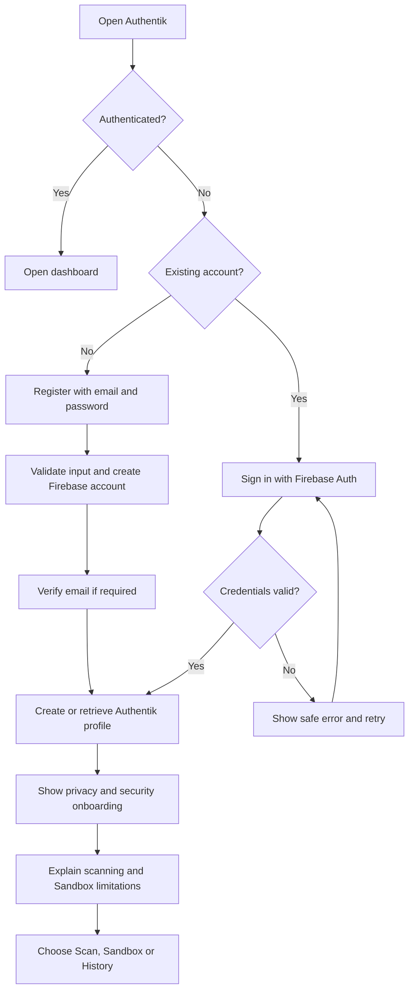

| Step | Implementation |
|---|---|
| Register / sign in / reset | `mobile/src/features/auth/identity.ts`. Passwords go to Firebase only. Error messages never reveal whether an account exists. |
| Profile create-or-retrieve | `GET /v1/me` → `AccountService.profile` |
| Onboarding | `mobile/src/app/onboarding.tsx` (three steps, plus the email-verification prompt); `PATCH /v1/me` |
| Route guards | `Stack.Protected` in `mobile/src/app/_layout.tsx`: signed out → auth screens; not onboarded → onboarding; otherwise the app |
| Sign out, revoke, delete, recovery | Settings → `POST /v1/me/sessions/revoke`, `DELETE /v1/me` (requires a recent sign-in), Firebase password reset |

## 2. Website scanning

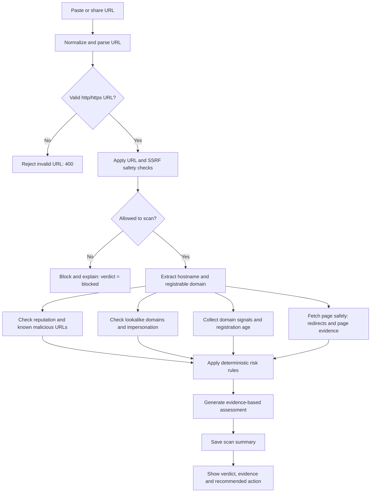

Implemented in `backend/src/modules/scans/service.ts`. The checks run in parallel, and each records
a `CheckRun`. When the page redirects to another domain, impersonation and reputation checks also
run on the destination.

| Outcome | Meaning | Rule |
|---|---|---|
| High risk | Credible malicious indicators or strong impersonation | Confirmed threat ≥ high; a critical indicator; high severity with high-quality evidence; or ≥ 2 high |
| Suspicious | One or more concerning signals | Any high/medium indicator, or ≥ 2 low |
| No obvious warnings | Every critical check ran and nothing was found | — |
| Inconclusive | A critical check (reputation) was unavailable | Never silently becomes "no warnings" |
| Scan blocked | The target violates the destination policy | Hard block (private IPs, internal names, non-web ports) |

A new or unrated domain is a *signal* (`recently_registered`, medium), not a threat. HTTPS
produces no reassurance at all.

## 3. Sandbox: isolated browsing

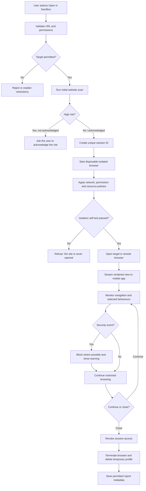

| Subflow | Behaviour | Where |
|---|---|---|
| Unexpected redirect | Main-frame domain change without user input within 2 s → `cross_domain_redirect` warning; the proxy still enforces the destination policy | `sandbox-worker/src/browser/session.ts` |
| Prohibited destination | Refused by the per-session egress proxy → `blocked_destination` (critical) | `network-policy/egress-proxy.ts` |
| Download attempt | `acceptDownloads: false` plus cancel → `download_blocked` | `session.ts` |
| Permission request | Empty permission set (always denied) plus a probe → `permission_denied` | `session.ts` |
| Pop-ups, dialogs, file pickers | Closed, dismissed or blocked, then reported | `session.ts` |
| Crash or timeout | `browser_crashed` → session destroyed; a new session can be started | `lifecycle/manager.ts`, `sessions/service.ts` |
| Expiry or idle | TTL (10 min default; worker hard cap 15 min) and idle timeout (2 min with no viewer) | reaper in `sessions/service.ts`; timer in `manager.ts` |
| Isolation failure | Proxy stops, or the self-test fails → `isolation_failure`, immediate teardown, error-level audit | `session.ts`, `sessions/service.ts` |
| User navigates to a blocked address | The viewer is told and the user's action is audited, but it is **not** counted against the site | `sessions/service.ts` |

The Sandbox never imports the user's cookies, profile or sessions. Every session gets a fresh
browser process with a throwaway profile.

## 4. Payment-flow integrity

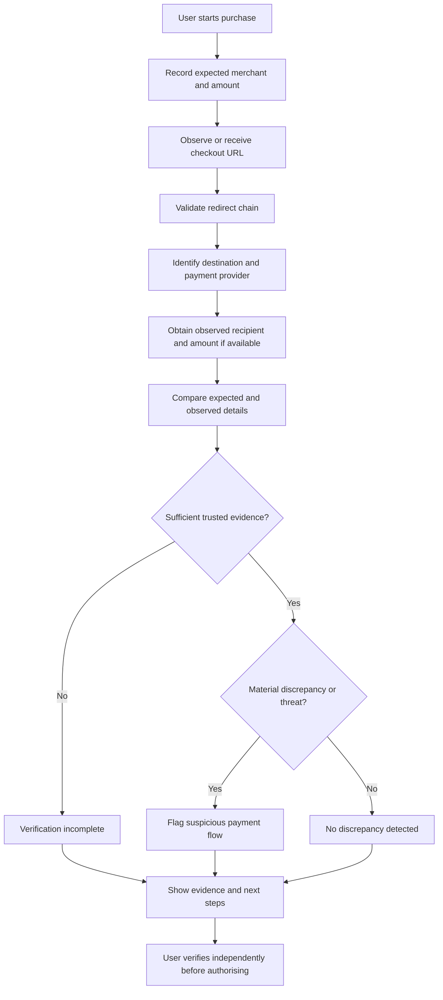

Implemented in `backend/src/modules/payment-integrity/service.ts`. The MVP uses a **simulated
checkout** (seven scenarios on reserved `.test` domains) or details the user types in. It cannot
see inside third-party apps.

| Check | Finding codes |
|---|---|
| Unexpected or unrecognised redirects | `unrecognised_payment_redirect` (medium; high when the host imitates a brand), `unexpected_payment_provider` (low) |
| Imitation of a merchant or provider | `lookalike_domain`, `brand_in_subdomain`, … (shared with the scanner) |
| Recipient ≠ merchant | `payment_recipient_mismatch` (high) |
| Amount differences | `amount_matches`, `amount_within_adjustment` (allowed fees and delivery), `payment_amount_mismatch` (medium/high), `payment_amount_lower` (low), `payment_currency_mismatch` |
| Missing or contradictory evidence | `merchant_unknown`, `recipient_not_observed`, `amount_not_observed` → `inconclusive` |

A redirect to a recognised payment provider that the merchant is known to use produces
reassurance. A new or unknown processor is "suspicious — verify", never automatically
"malicious". Each organisation in the redirect chain is judged once, so a provider moving
between its own domains (`payfast.co.za` → `payfast.io`) counts as a single signal.

### Reading the amount and recipient automatically

`POST /v1/payment-checks/extract` takes either `{ checkoutUrl }` (opened in a throwaway
isolated browser) or `{ sandboxSessionId }` (reads the page the user has browsed to in the
Sandbox). The page is rendered **only in the worker**, never on the API, because it's untrusted and
often needs JavaScript to show its total.

- **What gets read** (`sandbox-worker/src/browser/extract.ts`): structured data (JSON-LD, microdata, price meta tags), then text next to labels ("Total due", "Amount payable", "Pay to", "Merchant", …), then "Pay R…" buttons, then loose amounts on the page, which count as weak evidence. Kinds of evidence that agree raise confidence. Two strongly labelled, different totals are never guessed between: the user picks.
- **Where the logic runs**: the in-page part only collects size-capped raw text. Interpretation happens in the worker, outside the page's reach.
- **Where the full address stays**: page URLs can carry payment-session tokens, so the full URL stays on the server for 10 minutes under an `extractionId`. The phone receives only a redacted address and the values read.
- **How values are merged**: in `POST /v1/payment-checks`, any value the user leaves empty is taken from the page. A value the user types that differs from the page raises `contradictory_payment_evidence` (medium). Reports record each value's source as `page`, `page_confirmed` or `user`.
- **The limit**: these are the page's own claims, and a fraudulent page can display false values. The app says so, and still tells the user to confirm on their bank's approval screen.

## 5. Unified risk engine

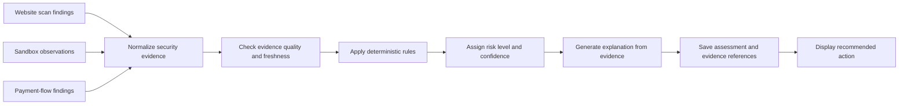

`backend/src/modules/risk-engine/`. See [architecture.md](architecture.md#the-risk-model).

## 6. History and detailed reports

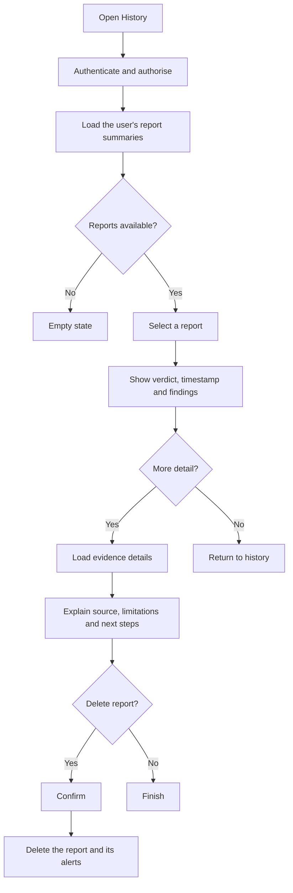

Every report shows the domain and time; findings grouped as confirmed threats, warning signs,
unknowns and reassurance, each with its source and evidence quality; redirects; recommended
actions; and whether the assessment was partial. Stored URLs are redacted: no query values, no
fragments, and no path segments that look like tokens.

## 7. Alerts and notifications

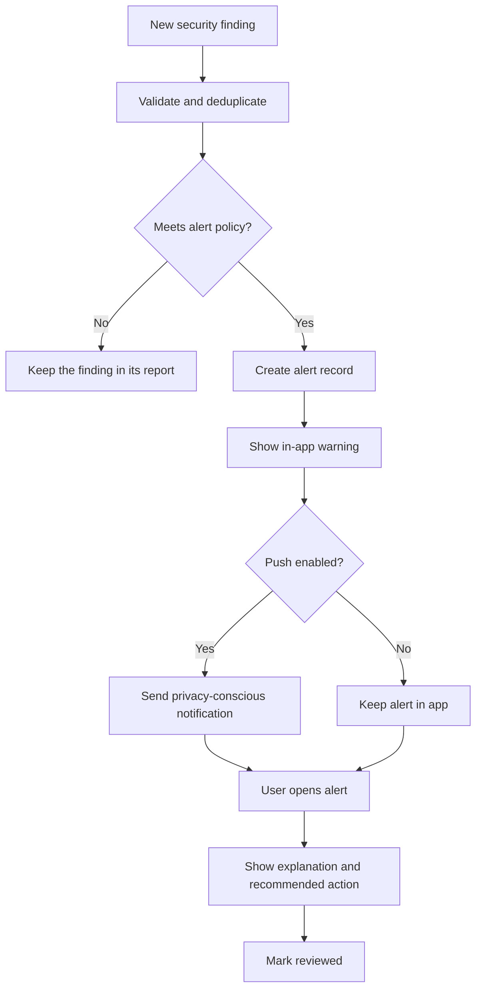

The policy (`modules/notifications/service.ts`): a confirmed threat of high severity or above,
or one of these codes at high severity or above: `credential_harvest`, `lookalike_domain`,
`blocked_destination`, `payment_recipient_mismatch`, `payment_amount_mismatch`, and similar.
Each report raises at most one alert, and alerts are deduplicated per code and domain for 24
hours. Push text is generic by default, never includes a URL or an amount, and Android shows it
with `PRIVATE` lock-screen visibility.

## 8. Settings, privacy and account controls

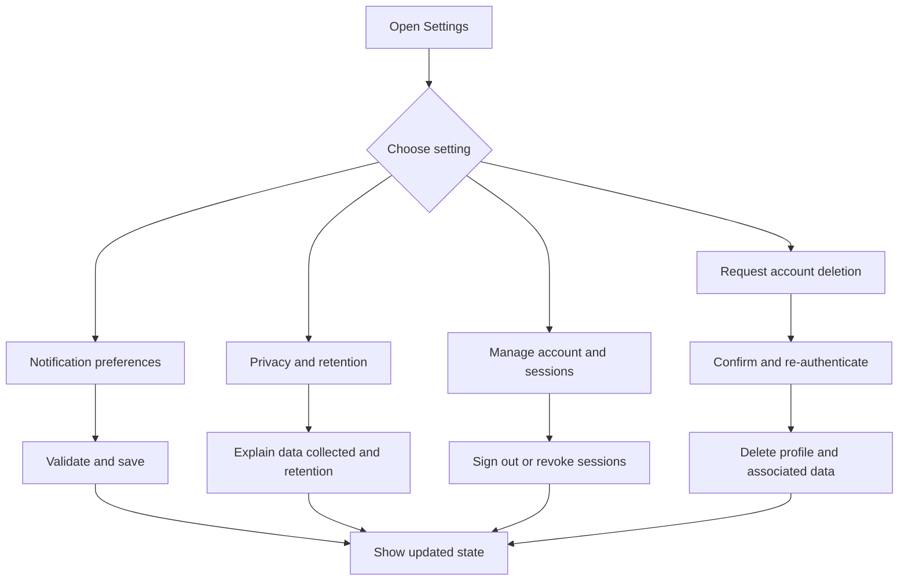

The privacy screen is rendered from `GET /v1/privacy`, which is generated by
`SettingsService.privacyStatement()` from the live configuration. It states plainly that
deleting a report does **not** delete audit-log entries.

## 9. Backend security and Sandbox session management

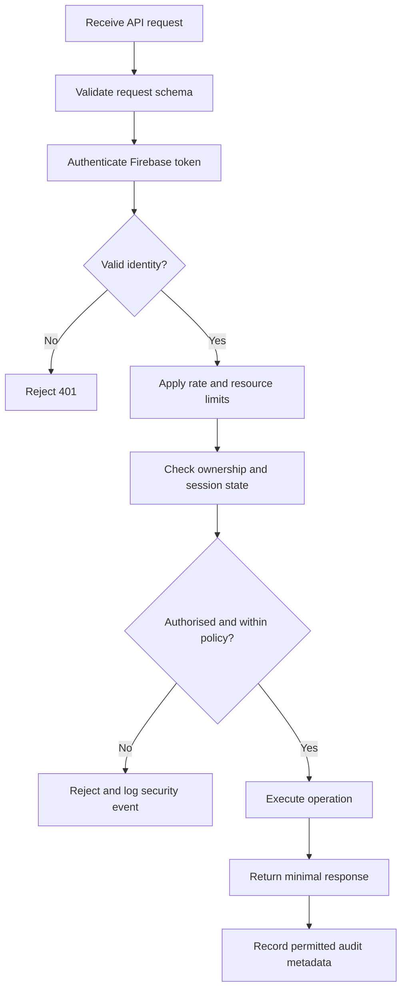

In the implementation, authentication happens before schema validation, so unauthenticated
callers learn nothing about the schema. The Sandbox lifecycle manager is described in
[architecture.md](architecture.md#sandbox-session-lifecycle).

## 10. Future retailer, payment-provider and banking integrations

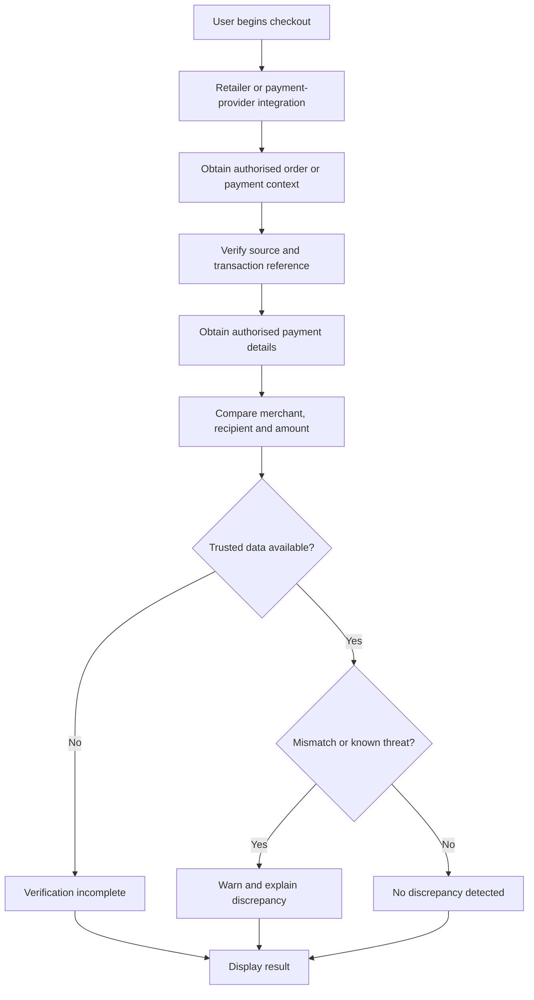

The extension point is `backend/src/integrations/types.ts` (`PaymentContextProvider`). An
integration supplies an `ObservedPayment` from an official, consented interface, and the
existing payment-integrity comparison does the rest. Authentik must not bypass another app's
security controls.

## 11. Operations and incident handling

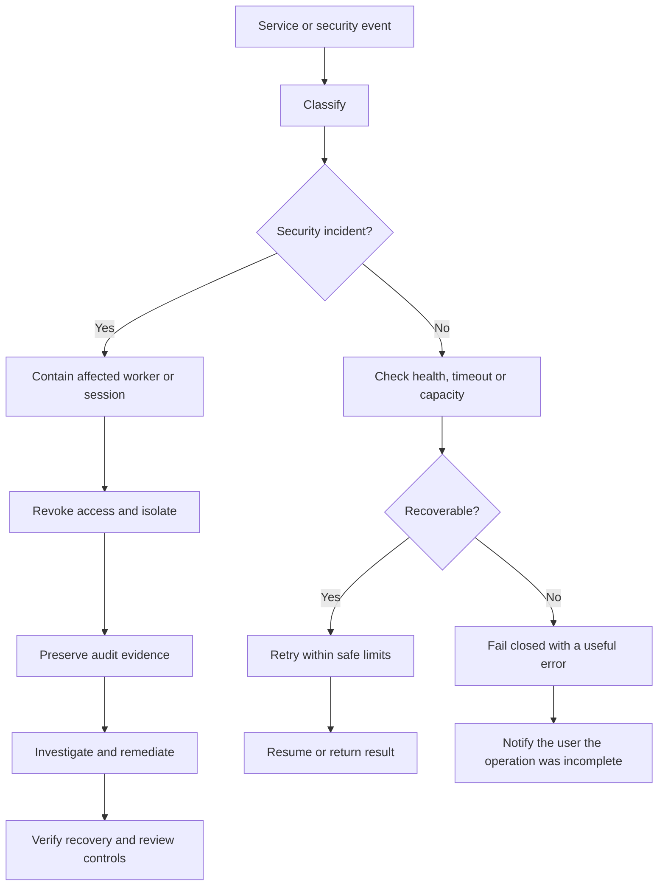

Fail-closed behaviours in code:

- Reputation provider down → the scan is `inconclusive` and the check reads "unavailable".
- Page fetch failed → the assessment is `partial`, and the explanation says which check is missing.
- Worker not configured, unreachable, or failing the isolation self-test → `503`, and the site is never opened.
- Isolation failure mid-session → immediate teardown and an error-level log.
- Worker protocol errors (more than 20 malformed messages) → the session is terminated.
- Repeated policy violations from one actor → an error-level audit log entry for paging.

See [threat-model.md](threat-model.md) for the incident runbook.
