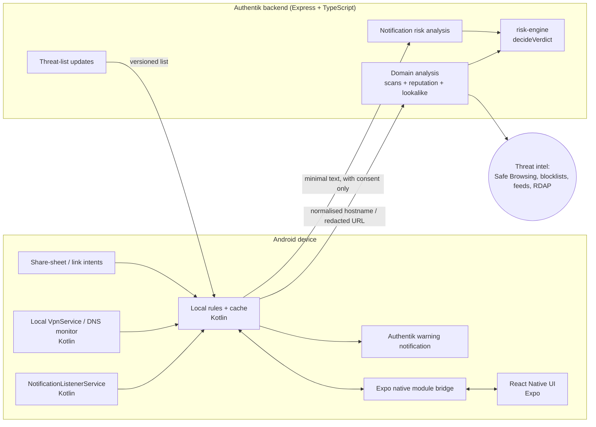

# Product scope: Android automatic fraud detection

Authentik is an **Android-first financial security companion**. It watches the signals Android
lets an ordinary app see, checks suspicious domains and notifications, and warns the user
*before* they trust a fraudulent payment claim or website.

We don't promise that Android lets us inspect everything, because it doesn't. Coverage comes
from several Android capabilities, and each one has limits that we state to the user.

> This scope replaces the original "scan / Sandbox / payment check" product framing (2026-10-24).
> The existing code stays and is reused. See [How the existing code fits](#how-the-existing-code-fits).

## What Authentik monitors

| Area | What it detects | Feasibility |
|---|---|---|
| **A. Incoming notifications** | Fake bank alerts, fake "payment received" confirmations, fraudulent delivery fees, refund scams, requests for banking credentials | Feasible on Android once the user grants notification access |
| **B. Website and domain navigation** | Known-malicious domains, redirects, look-alike financial brands, suspicious checkout pages | Coverage depends on the integration (VPN/DNS, share sheet, notification links) |
| **C. Payment-risk signals** | Correlates a suspicious notification with known-bad domains, payment requests and impersonation into **one** warning | Needs evidence and careful correlation |

Two limits are part of the product, not bugs:

- A notification that says "payment successful" is a **claim**. Authentik can't confirm that
  money reached anyone's bank account. The answer is always "check in your own banking app".
- Domain analysis finds warning signs. It never proves a site is safe. Missing evidence stays
  `inconclusive`.

## Android capabilities and their limits

| Capability | What Authentik can do | What it can't guarantee |
|---|---|---|
| `NotificationListenerService` | Read notifications as they're posted, with the posting app's package, after the user enables notification access | Read messages inside apps, or content an app leaves out of its notification |
| `VpnService` (local, on-device) | Route traffic through a local VPN for domain-level (DNS) filtering | See full URLs or decrypt HTTPS. It sees DNS lookups, not pages |
| Link intents / share sheet (`ACTION_SEND`, `ACTION_VIEW`) | Analyse links the user or another app explicitly sends to Authentik | Intercept links other apps open on their own |
| Accessibility service | **Not used.** | Google Play restricts it heavily, and it isn't a general-purpose monitor. It's not a dependency for any phase |

The design: **notification access** for fake-notification detection, a **local VPN** for broad
domain-level protection, and **explicit link sharing** (plus links pulled from notifications)
for full-URL analysis.

## Architecture

### Stack

- **Mobile UI**: the existing Expo / React Native app (onboarding, settings, history, warnings).
- **Native Android layer**: Kotlin, as a local Expo native module in
  `mobile/modules/authentik-protection/`. Its own manifest declares the service, and autolinking
  merges it. It holds the notification listener, VPN service, local rules
  and cache, and lifecycle handling. These must be **native services**, not JavaScript
  background tasks, so they keep running when the JS runtime is suspended or the UI is closed.
  This needs a development build (`expo prebuild` / EAS). Expo Go can't load it.
- **Backend**: the existing Express 5 + TypeScript API.
- **Domain intelligence**: DNS and RDAP registration data, threat-intelligence and reputation
  feeds, redirect analysis, and domain similarity (the existing `lookalike` module).
- **AI**: only for wording or for flagging ambiguous notification text. Deterministic rules decide
  high-confidence cases, and `decideVerdict` decides the verdict (see below).
- **Storage**: a local cache on the phone. The backend stores only opted-in scan history and
  security events.

## Fake-notification detection (first fully automatic feature)

Pipeline, all on the device unless stated:

1. **Receive**: the Kotlin service gets `onNotificationPosted()`.
2. **Filter**: ignore irrelevant notifications. Redact OTPs, card numbers and account numbers
   before anything else touches the text.
3. **Analyse**: deterministic rules for payment claims, urgency, impersonation and links.
4. **Check the domain**: if there's a link, send its **normalised hostname** to the local
   threat cache, then the backend domain engine.
5. **Score**: combine independent evidence through the same risk model as everything else.
6. **Warn**: post an Authentik notification with the reasons and what to do next.

The **posting app** and the **sender named in the message** are different things. A scam SMS
arrives through a legitimate messaging app, so the package name alone doesn't make a message
fraudulent or genuine. A bank alert posted by an SMS app, though, doesn't come from the bank's
own app, and that's useful evidence.

Example warning for "Payment successful. You have received R4,500.00. Release the item now.":

> **Don't release the item yet.** A notification saying a payment arrived doesn't confirm the
> money reached your account. Check the transaction in your own banking app before handing over
> the goods.

Obvious high-confidence cases are handled locally. Notification text goes to the backend only
when the user has opted in, and only after local redaction.

## Domain checking (two layers)

**Layer 1: local VPN / DNS protection (broad coverage).** A `VpnService` sees DNS lookups from
most apps and matches them against a local threat cache. The user approves the VPN, Android
shows a persistent notification while it runs, and only one VPN can be active per user/profile.
Private DNS, DNS-over-HTTPS, cached lookups and direct-IP connections reduce what it sees. It
never sees the URL path or page contents.

Built as a DNS-only tunnel: only the VPN's own DNS address is routed into it, so no other
traffic passes through, and there's nothing to decrypt. Known-bad domains are blocked
(NXDOMAIN). Look-alikes are warned about but allowed, because blocking on a guess breaks things
people need. Google Play allows `VpnService` for device-security apps like this, with a
separate in-app disclosure and explicit consent, which the Web protection screen shows before
Android's own VPN dialog.

**Layer 2: full-URL analysis (deeper inspection).** When Authentik gets a full URL, from the
share sheet, a link intent, or a link in a notification, the backend analyses the host, path,
redirects and reputation. Reputation uses only free sources for now: Google Safe Browsing
(free, non-commercial use), the local blocklist and optional free feeds. Nothing needs a billing
account. A commercial launch needs a commercial provider such as Google Web Risk, which needs
billing, so that's deferred. In-app WebViews in other apps stay invisible.

What "before it loads" can mean:

- **Known-malicious domain**: can be interrupted at the DNS level.
- **Unknown domain with suspicious signals**: needs a full-URL scan or more reputation data
  before deciding whether to warn.
- **A bad page on a legitimate domain**: DNS filtering can't catch it. It needs the full URL.

Release 1 does known-threat blocking and domain-risk warnings. It doesn't promise universal
pre-navigation protection.

## Backend API

Additions under the existing authenticated `/v1` prefix (same middleware pipeline, Zod
validation and 404 rules as the current API):

| Endpoint | Purpose |
|---|---|
| `POST /v1/domains/analyze` | Analyse a hostname or URL. Reuses the `scans` pipeline. `quick` (default) doesn't visit the site; `full` fetches the page. Not stored |
| `POST /v1/notifications/analyze` | Combine the phone's finding **codes** with a quick check of each link host (max 5). **No notification text is sent**; the server owns the codes' severities. Not stored |
| `GET /v1/threats/updates?since=<version>` | Versioned threat-list deltas for the on-device cache. Carries no user data |
| `POST /v1/reports/feedback` | Optional false-positive / missed-scam feedback (Phase 4) |

Why codes instead of text: the phone already redacts and analyses the text, and the server's
value is the domain check. Sending codes and hostnames gets the same correlated answer without
the message ever leaving the phone. If server-side text analysis (e.g. an AI layer) is ever
added, it needs its own explicit opt-in.

The native listener can't call the API itself, because the sign-in token lives in the JS
runtime, which may be suspended. So offline link checks use the downloaded threat list, which
the app refreshes whenever it opens. Online checks run from the app when the user asks.

Responses use the existing `Assessment` type (`packages/shared/src/risk.ts`), not a new shape:
`verdict` (`high_risk | suspicious | no_obvious_warnings | inconclusive | blocked`), a
categorical `confidence`, `completeness`, `findings`, `checks`, `recommendedActions` and
`rulesVersion`. Notification analysis adds new `FindingSource` values (e.g. `notification`,
`dns`). The verdict is still decided only in `decideVerdict`. Numeric confidence scores,
especially ones from a model, aren't used, and `inconclusive` is always a valid answer.

Every server-side fetch of a submitted URL still goes through `SafeFetcher`: private and
internal ranges blocked, every redirect re-validated, the scanner isolated from internal
infrastructure.

## Privacy and Google Play

- Ask for notification access and VPN consent **separately**, and explain each one before
  opening Android Settings.
- Process notification text on the device by default. Never collect OTPs or notification
  history by default.
- Keep threat-list downloads separate from anything user-specific.
- Make monitoring controls obvious, with a single way to turn protection off.
- Encrypt in transit and keep retention short (see [data retention](data-retention.md)).
- Before release, check Google Play's current `VpnService` declaration and disclosure
  requirements, and the notification-access policy.

## How the existing code fits

| Existing piece | Role in the new scope |
|---|---|
| `scans`, `reputation`, `lookalike`, RDAP, `SafeFetcher` | The core of the **domain engine** (Phase 2) |
| `risk-engine` | Unchanged as the single place verdicts are decided. Gains notification and DNS findings |
| `payment-integrity` | The "payment claim vs. reality" rules feed **payment-risk signals** (area C) |
| `sandbox-worker` | The isolated scanner for JavaScript redirects and checkout pages a plain fetch can't render. No longer a headline feature |
| `notifications` (FCM), `reports`, `settings`, `auth` | Kept as is |
| Mobile app | Kept. Gains onboarding for the two permissions, protection status, and warning history. Sandbox and manual scan screens become secondary |

iOS isn't in scope for automatic detection, because iOS exposes none of these capabilities to
third-party apps. The app still builds for iOS with the manual features.
